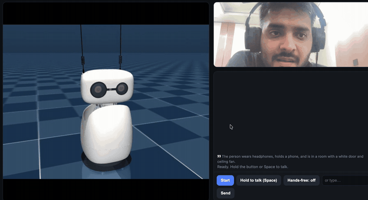
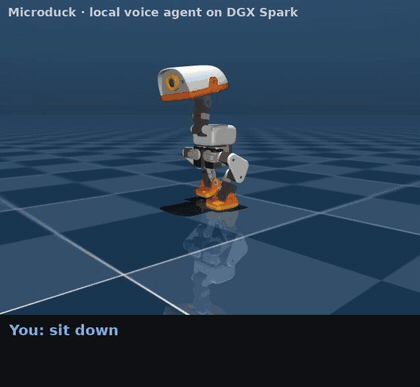

# reachy-mini-local-agent

A fully local, voice + vision companion for the **Reachy Mini** robot (simulated in MuJoCo), running on a single
**NVIDIA DGX Spark**. You talk to it from a browser on your laptop (camera + mic); it listens, looks at you, searches the
web when it needs facts, answers in a natural Indian-English voice, and moves its head and antennas like it means it.

Inspired by the Hugging Face × NVIDIA post
[“NVIDIA brings agents to life with DGX Spark and Reachy Mini”](https://huggingface.co/blog/nvidia-reachy-mini)
([reference repo](https://github.com/brevdev/reachy-personal-assistant)), rebuilt with **small open models only, no cloud APIs**.

## Demo
[](assets/demo.mp4)

▶️ **[Watch the full demo with sound (MP4, 31 s)](assets/demo.mp4)**: greeting, describing what it sees through the
webcam, and a web-search hand-off, with the robot reacting in the MuJoCo sim.

```
 Mac browser (camera + mic)  ──ssh tunnel :8090──►  DGX Spark
   │ push-to-talk / hands-free                        │
   │ webcam frames (3/s)                              ├─ Whisper large-v3-turbo        speech → text
   │                                                  ├─ router (regex fast-path + LFM2.5)
   │                                                  │    chat     → LFM2.5-1.2B (vLLM)
   │                                                  │    robot    → LFM2.5 tool calls → Reachy SDK
   │                                                  │    vision   → Qwen2.5-VL-3B (vLLM)
   │                                                  │    search   → DuckDuckGo → Wikipedia fallback → LFM2.5
   │                                                  ├─ emotion picker (vLLM guided choice over Pollen's library)
   │ ◄── streamed PCM (WebAudio) ─────────────────────├─ rumik-oss-1 TTS, NVFP4 on vLLM, phrase-parallel + chunked Mimi
   │ ◄── MJPEG of the sim ────────────────────────────├─ "life" loop: breathing, face-follow, listening/thinking poses,
                                                      │   speech-synced head + antennas, recorded emotions & dances
                                                      └─ Reachy Mini daemon (MuJoCo sim)
```

## Microduck too
The same brain also drives Pollen's **[Microduck](https://pollen-robotics.com/microduck/)**, the 25 cm open-source
biped duck, in its MuJoCo simulator: `ROBOT=duck python web.py`.

[](assets/duck_demo.mp4)

▶️ **[Full Microduck demo with voice (MP4, 1:42)](assets/duck_demo.mp4)**: greet, sit, stand, peck the floor, kick,
look, nod, dance and chat, every action picked by LFM2.5 from a spoken-style request.

| | Reachy Mini | Microduck |
|---|---|---|
| Control | Python SDK, direct head poses | JSON-RPC to `robotd` over a Unix socket; continuous intents streamed at 20 Hz (500 ms deadman) |
| Agent tools | look, tilt, nod, shake, express (85 emotions), dance (19), sleep, wake | sit, stand, peck (`ground_pick`), kick, look, nod, shake, quack, emote (13 trained emotions), dance |
| Live motion | breathing, face-follow, listening/thinking poses, speech-synced head + antennas | idle bob, face-follow, listening/thinking poses, head bob + beak with the voice |
| Sim view | `viewer.py` | `duck_viewer.py` mirrors robotd's 14 joints + odometry into an offscreen render |

Setup: build [pollen-robotics/microduck](https://github.com/pollen-robotics/microduck) (`cargo build -p robotd -p robotctl -p tof -p sounds -p configd -p updater`;
the full workspace also needs GStreamer/glib headers for `mediad`), `uv sync` in
[microduck_rl](https://github.com/pollen-robotics/microduck_rl) (`develop`), then
`DUCK_SIM_RL=/path/to/microduck_rl DUCK_SIM_VIEWER=0 scripts/duck-sim` from the microduck repo.

Known limits in the sim on a DGX Spark: walking and turning do not track the command (Pollen's own `duck-sim drive`
reports the same; see their `docs/design/simulation.md`, "Ways to pick the wrong model"), and the beak is not among the
14 reported joints, so lip-sync shows as head motion. Sit/stand, peck, kicks and the emotion skills all move the body.

The sim view in the browser can be orbited (drag), zoomed (scroll) and reset (double-click), for both robots.

## What it does
- **Talks like a person**: casual persona, short replies, English / Hindi / Hinglish, `<laugh>` / `<sigh>` voiced by rumik.
- **Sees you**: YuNet face tracking → Reachy follows your face; every ~6 s the VLM captions the scene and the persona can
  mention it ("oh, nice headphones"). "What am I holding?" goes straight to the VLM with the current frame.
- **Moves expressively**: 85 emotions + 19 dances from Pollen's recorded libraries, tool calls (`look`, `tilt_head`, `nod`,
  `shake_head`, `express`, `dance`, `sleep`, `wake_up`), and an always-on motion loop (idle breathing, glances, lean-in while
  you talk, look-away while thinking, head + antennas driven by the voice envelope while speaking).
- **Knows current facts**: a web search tool with query clean-up and follow-up resolution ("their district app" →
  `Zomato district app`), DuckDuckGo with retries and a Wikipedia fallback.
- **Streams its voice**: first sound ~2–4 s after the answer is ready instead of 13–28 s.

## Models
| Role | Model | Served by |
|---|---|---|
| Router, chat, tool calls | [LiquidAI/LFM2.5-1.2B-Instruct](https://huggingface.co/LiquidAI/LFM2.5-1.2B-Instruct) | vLLM :8010 |
| Vision | [Qwen/Qwen2.5-VL-3B-Instruct](https://huggingface.co/Qwen/Qwen2.5-VL-3B-Instruct) (or LFM2-VL) | vLLM :8011 |
| Voice | [rumik-ai/rumik-oss-1](https://huggingface.co/rumik-ai/rumik-oss-1) (Ira), NVFP4 export: [Sanyam0605/rumik-oss-1-nvfp4-vllm](https://huggingface.co/Sanyam0605/rumik-oss-1-nvfp4-vllm) | vLLM :8004 + `tts_stream.py` :8003 |
| Speech recognition | [openai/whisper-large-v3-turbo](https://huggingface.co/openai/whisper-large-v3-turbo) | in `web.py` |
| Optional reasoner | NVIDIA Nemotron-3-Nano-30B-A3B (NVFP4) | vLLM :8012 |
| Robot | [Reachy Mini SDK](https://github.com/pollen-robotics/reachy_mini) + MuJoCo sim | daemon :8000 |
| Expressions | [emotions](https://huggingface.co/datasets/pollen-robotics/reachy-mini-emotions-library) / [dances](https://huggingface.co/datasets/pollen-robotics/reachy-mini-dances-library) libraries | Reachy SDK |

## Making the voice fast on a DGX Spark
rumik-oss-1 emits 100 audio tokens per second of speech, so real time needs 100 tok/s. On the GB10, one request
decodes at **~51 tok/s**: every step reads the ~2.5 GB weights and memory bandwidth (~273 GB/s) caps a single stream
near 100 tok/s before overhead. Batched throughput is much higher, so `tts_stream.py`:

1. splits the reply into short phrases (short first phrase),
2. generates up to 3 phrases **concurrently** in vLLM, in order,
3. decodes Mimi frames in chunks as they arrive (1 s first chunk, 16 frames of left context, an idea from
   [ira-tts-webgpu PR #1](https://github.com/Sj0605-DataSci/ira-tts-webgpu/pull/1)), and streams PCM to the browser,
4. caps each phrase's token budget by its word count, so a phrase can't babble on.

| | before (transformers server) | after |
|---|---|---|
| first sound after the answer | 13–28 s | ~2–4 s |
| playback | whole clip at the end | streamed, ~0.4–2 s of small gaps per reply |

## Setup (DGX Spark / any Linux box with an NVIDIA GPU)
1. Python env (uv) with `requirements.txt`. If `pygobject` fails to build (no cairo headers), install
   `reachy-mini` with `--no-deps`, install its other deps without `pygobject`/`gstreamer-bundle`, and symlink the system
   `/usr/lib/python3/dist-packages/{gi,cairo}` into the venv's `site-packages`.
2. Docker image `vllm/vllm-openai:v0.20.0` (override with `VLLM_IMAGE`).
3. Models: `hf download LiquidAI/LFM2.5-1.2B-Instruct`, `Qwen/Qwen2.5-VL-3B-Instruct`, `openai/whisper-large-v3-turbo`,
   and `hf download --repo-type dataset pollen-robotics/reachy-mini-emotions-library` (same for `-dances-library`).
   Voice: `hf download Sanyam0605/rumik-oss-1-nvfp4-vllm --local-dir models/rumik-nvfp4` and set
   `RUMIK_MODEL_DIR=models/rumik-nvfp4` (NVFP4 needs a Blackwell GPU such as the GB10; it was exported with
   `quantize_for_vllm.py` from [rumik-oss-model-dissection](https://github.com/Sj0605-DataSci/rumik-oss-model-dissection)).
   On other GPUs use bf16 `rumik-ai/rumik-oss-1` and set `RUMIK_QUANT=`.
4. On a GB10, cap clocks before heavy jobs: `sudo nvidia-smi -lgc 0,1500`.

## Run (one tmux window each)
```bash
scripts/sim.sh --headless                       # Reachy Mini daemon :8000
scripts/serve_llm.sh                            # LFM2.5 :8010
scripts/serve_vlm.sh                            # Qwen2.5-VL :8011
RUMIK_MODEL_DIR=/path/to/rumik scripts/serve_rumik_vllm.sh   # rumik on vLLM :8004
RUMIK_MODEL_DIR=/path/to/rumik scripts/serve_tts.sh          # streaming TTS :8003 (needs the same dir for tokenizer + codec)
python web.py                                   # web app :8090 (+ sim renderer :8091)
```
From your laptop: `ssh -N -L 8090:localhost:8090 <user>@<spark>` and open http://localhost:8090 (localhost is a secure
origin, so the browser allows camera + mic). Click **Start**, then hold **Space** to talk or switch on **Hands-free**.

Text-only CLI: `python agent.py` (add `--mic` for a local mic, `--no-robot` without the sim).

## Files
| file | what |
|---|---|
| `web.py` / `web.html` | browser app: STT, turn handling, camera frames → face + captions, streamed voice, sim stream relay |
| `agent.py` | router, LLM chat, tool-calling agent, vision, web search, emotion picker, reply clean-up |
| `life.py` | 20 Hz motion loop that owns the robot: modes, face-follow, speech-synced motion, recorded moves |
| `tts_stream.py` | phrase-parallel streaming TTS on top of rumik-on-vLLM |
| `viewer.py` | offscreen MuJoCo render of the live robot state as MJPEG (no X needed over SSH), orbit camera via `/cam` |
| `duck_robot.py` / `duck_viewer.py` | Microduck adapter (robotd JSON-RPC, tools, motion loop) and its sim view |
| `scripts/record_demo.py` | scripted demo recorder: sim stream + streamed voice → captioned MP4 |
| `vllm-plugin/` | out-of-tree vLLM model plugin for rumik-oss-1 (TinyAya) |
| `scripts/` | launchers for the sim and each model server |

## Gotchas we hit
- vLLM 0.20 has no LFM2 tool parser: send `tools` with `tool_choice="none"` (the chat template still renders them),
  `skip_special_tokens=False`, and parse `<|tool_call_start|>[fn(a=1)]<|tool_call_end|>` yourself.
- vLLM's CUDA-graph memory estimate starved the KV cache on small models: `--max-num-seqs 8` and
  `VLLM_MEMORY_PROFILER_ESTIMATE_CUDAGRAPHS=0`.
- MuJoCo's EGL renderer crashed when run in the same process as torch/CUDA: it runs as a separate process.
- OpenCV 5 dropped Haar cascades: face tracking uses YuNet (auto-downloaded).
- A 1.2B router misses obvious intents ("nod and look happy" → chat): regex fast-paths for move / vision / search words.
- rumik sometimes speaks the `<description=…>` style tag aloud on very short phrases.
- `--no-localhost-only` from the blog no longer exists in reachy-mini 1.14.

## Licences
Code: MIT. Models and datasets keep their own licences; notably **rumik-oss-1 is CC-BY-NC** (non-commercial).
